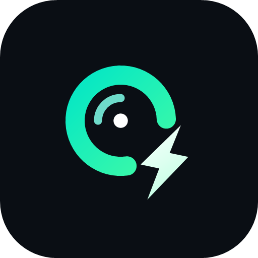

  

<h1 align="center">Qonecta Unit CORE</h1>

  <b>by <a href="https://github.com/CharlysEV">CharlysEV</a></b> 
  <b>Android Auto &amp; Apple CarPlay</b> directly on your Leapmotor C10 head unit — <b>classic CORE edition (without the Extended system)</b>

  <a href="https://github.com/CharlysEV/qonecta-unit-core/releases"><b>⬇ Download APK (Releases)</b></a> ·
  <a href="https://github.com/CharlysEV/qonecta-unit-core/issues"><b>🐞 Report an Issue (GitHub Issues)</b></a> ·
  <a href="https://ko-fi.com/charlysev"><b>☕ Ko-fi</b></a> ·
  <a href="https://www.paypal.me/CharlysEV"><b>💙 PayPal</b></a>

---

## What is Qonecta Unit CORE?

**Qonecta Unit CORE** is the clean, classic, ultra-lightweight edition built exclusively for **Android Auto** and **Apple CarPlay** directly on the car's screen (designed and tested on **Leapmotor C10**).

> [!IMPORTANT]
> **CORE edition — ONLY Android Auto & Apple CarPlay (NO Extended system):**
> - **No** Extended side panel, **no** Companion bridge, **no** boot receivers, **no** background services, and **no** microphone HAL capture (`RECORD_AUDIO` removed).
> - Engineered for maximum stability, zero crashes/reboots on the C10 head unit, and crisp full-screen projection.

### Main Features

- ✅ **Android Auto** — Wireless **5 GHz Wi-Fi Direct**, **Mobile Hotspot**, or **USB Cable** (direct + charging).
- ✅ **Apple CarPlay** — Wireless **5 GHz Wi-Fi Direct**, **Car Hotspot**, or **USB Cable** (built-in local authentication — no external dongle required).
- ✅ **Optional 2nd Screen (Instrument Cluster / Display 2)** — Disabled by default for maximum safety; 1-tap toggle (`Cluster: ON/OFF`) shows live navigation map on the instrument cluster.
- ✅ **Full Multi-Language Interface** — **Español · Português · English · Italiano · Deutsch** (and automatic system language detection + in-app language picker).
- ✅ **Built-in Car File Manager** — Easy future APK updates directly from a USB drive.
- ✅ **100% Free & Open Source** (AGPL-3.0 / GPL-3.0).

---

## User Manuals (All Qonecta+ Languages)

Step-by-step driver guide: installation on Leapmotor C10, Android Auto & Apple CarPlay connection (Wi-Fi 5 GHz, Hotspot, USB), optional 2nd screen, settings, troubleshooting, and log export:

- 🇪🇸 **Español:** [MANUAL.md](MANUAL.md)
- 🇵🇹🇧🇷 **Português:** [MANUAL.pt.md](MANUAL.pt.md)
- 🇬🇧🇺🇸 **English:** [MANUAL.en.md](MANUAL.en.md)
- 🇮🇹 **Italiano:** [MANUAL.it.md](MANUAL.it.md)
- 🇩🇪 **Deutsch:** [MANUAL.de.md](MANUAL.de.md)

---

## Report Bugs & Feedback (GitHub Issues)

Found a bug, connection quirk, or have feedback? Please open an issue in the **GitHub Issues** tab so we can track and fix it:

👉 **[https://github.com/CharlysEV/qonecta-unit-core/issues](https://github.com/CharlysEV/qonecta-unit-core/issues)**

*(You can write in Spanish, English, German, Italian, or Portuguese. Including your car firmware, phone model, connection mode — Wi-Fi 5 GHz / Hotspot / USB — and exported logs helps fix issues much faster! You can also scan the built-in QR code directly from **Settings → Report a problem** inside the app.)*

---

## Support the Project

**Qonecta Unit CORE** is free, open source, and ad-free. If it makes your daily drives better and you'd like to buy me a coffee:

- ☕ **Ko-fi:** [https://ko-fi.com/charlysev](https://ko-fi.com/charlysev)
- 💙 **PayPal:** [https://www.paypal.me/CharlysEV](https://www.paypal.me/CharlysEV)

Thank you! ❤️

---

## Open-Source Credits & Licenses

- Built on top of [Open Headunit](https://github.com/andreknieriem/open-headunit) / [DiAuto](https://github.com/shihabal3amri/DiAuto) (AGPL-3.0) and [xcertplay](https://github.com/shilapi/xcertplay) (GPL-3.0).
- See [LICENSE](LICENSE), [COPYRIGHT_MICHAEL_REID_GPLv3AFFERO.txt](COPYRIGHT_MICHAEL_REID_GPLv3AFFERO.txt), and [PRIVACY.md](PRIVACY.md).
- Android Auto is a trademark of Google LLC. Apple CarPlay is a trademark of Apple Inc. Independent community project, not affiliated with Leapmotor, Google, or Apple.
